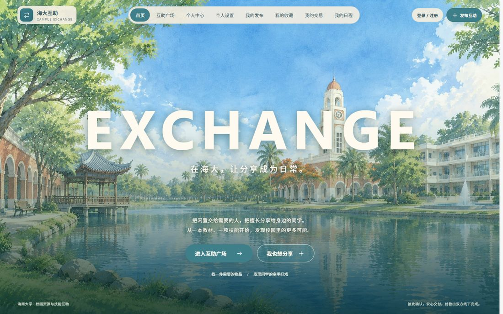
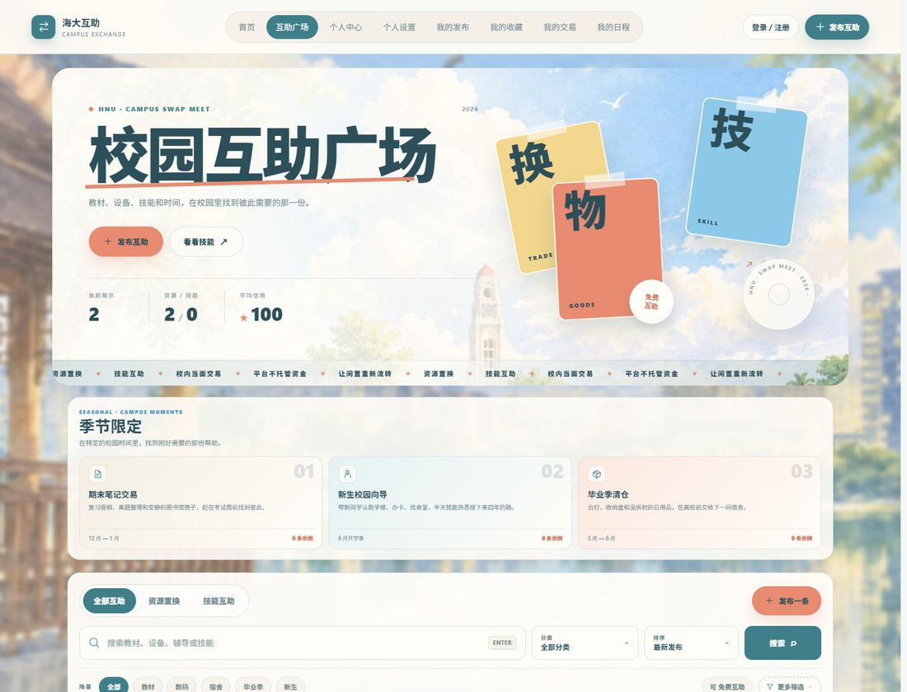
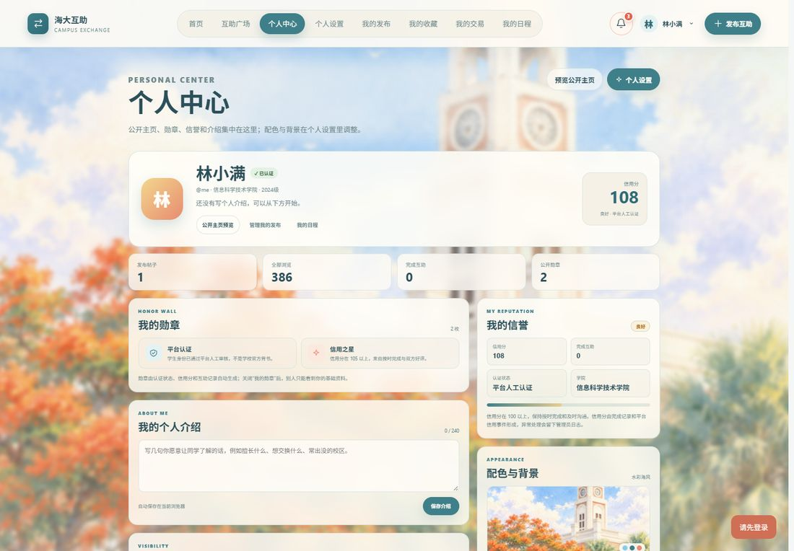
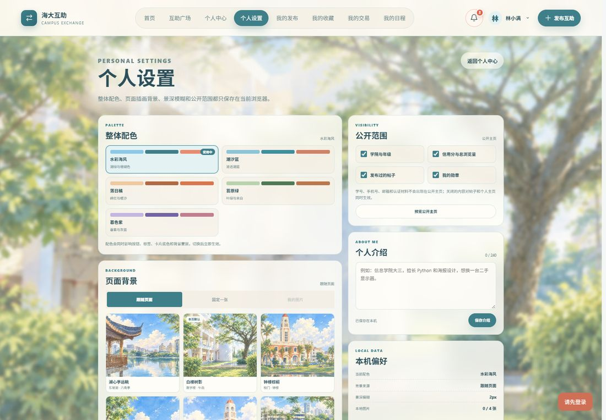

# 海南大学校园资源置换与技能互助平台

面向海南大学学生的前后端分离课程项目：把闲置资源与空闲技能放上广场，用「协议 + 双方确认」完成一次校内互助。平台不托管资金，付款由双方线下完成。

**技术栈**：Vue 3 · Vite · FastAPI · SQLAlchemy · Alembic · SQLite（开发）/ MySQL（生产）· Docker Compose

## 界面预览

| 首页 | 互助广场 |
| --- | --- |
|  |  |

| 个人中心 | 个人设置 |
| --- | --- |
|  |  |

## 功能一览

### 账号与学生认证
- 手机号 + 短信验证码注册 / 登录，管理员使用独立账号密码登录，JWT 鉴权
- 一次性挑战码 + 私密材料上传 + 管理员人工审核的学生认证；学号 AES-GCM 加密存储、接口只返回掩码
- 可选邮箱验证码绑定，邮箱只证明邮箱控制权，不被当作学生身份证明
- 可显式开启的课程演示认证与模拟付款，界面标注「课程演示」，不会声称连接学校或真实支付

### 广场与发布
- 资源 / 技能双轨看板，分类、搜索、场景标签、价格区间、成色、交付方式、校区等组合筛选
- 图片上传与公开详情、收藏、留言与感谢卡、举报
- 分区水彩背景与五套配色（水彩海风 / 潮汐蓝 / 落日橘 / 苔原绿 / 暮色紫）

### 交易与信用
- 交易请求 → 发布者接受 → 发起者确认协议 → 双方分别确认交付 / 收货 → 完成
- 交易内异步消息、完成后评价、信用事件与信用分
- 争议与举报进入管理员工作台，处理过程留有审计日志

### 个人中心与个性化
- 个人中心：勋章、信誉、公开范围（学院 / 数据 / 帖子 / 勋章）、个人介绍、我的发布、快捷入口
- 个人设置：整体配色、分区背景 / 固定背景 / 本机图片背景、景深模糊与蒙层浓度、本机偏好概览
- 本机图片最多保存 4 张，压缩到 1600px 后写入浏览器本地存储，不经过服务器

### 通知中心
- 铃铛通知由真实交易状态推导：收到请求、对方接受、协议达成、待确认收货 / 交付、完成、取消、拒绝
- 未读红点、分组展示（交易与日程 / 内置演示通知）、点开即已读、全部已读
- 每 25 秒静默轮询，窗口聚焦或页面恢复可见时立即刷新；新事件会弹出提示
- 点击通知直达对应交易弹窗，可直接接受 / 拒绝、确认协议、确认交付 / 收货

### 管理工作台
- 概览、认证审核、举报处理、内容管理、用户管理、分类管理、操作日志
- 下架 / 恢复帖子、加精、禁用账号、调整信用分，所有动作写入日志

## 项目结构

```text
backend/
  app/
    api/v1/        # 认证、发布、交易、社区、管理接口
    core/          # 配置、密码与加密
    services/      # 短信、邮件（开发环境走控制台）
    models.py      # SQLAlchemy 模型
    schemas.py     # Pydantic 输入输出
  alembic/         # 数据库迁移
  tests/           # pytest 接口测试
frontend/
  src/
    App.vue        # 单文件 SPA：路由状态、交易、通知与个人设置
    components/    # 首页、管理工作台、图标
    *.css          # 基础样式 + 广场 / 水彩 / 个性化主题层
  public/exchange/ # 校园插画、分区背景与手绘地图
docs/screenshots/  # README 预览图
sketches/          # 早期界面草图
```

## 本地运行

开发环境默认使用 SQLite，无需安装 MySQL 即可启动。

### 后端

```powershell
python -m pip install -r backend/requirements.txt
$env:PYTHONPATH='backend'
Set-Location backend
python -m alembic upgrade head
python -m uvicorn app.main:app --host 127.0.0.1 --port 8000
```

接口文档：`http://127.0.0.1:8000/docs`

### 前端

```powershell
Set-Location frontend
npm install
npm run dev -- --host 127.0.0.1
```

访问：`http://127.0.0.1:5173`

### 演示账号与开关

- 开发环境演示管理员：`admin / Admin123!`（仅开发环境，生产必须通过环境变量设置）
- 开发环境短信 / 邮箱验证码会直接出现在接口响应或页面提示中；生产环境不会返回验证码
- 课程演示认证与模拟付款默认启用；公开部署默认关闭，需要时显式设置 `DEMO_FEATURES_ENABLED=true`，并保留页面上的演示标识

## 测试

```powershell
$env:PYTHONPATH='backend'
python -m pytest backend/tests -q -p no:cacheprovider
Set-Location frontend
npm run build
```

## Docker 部署

1. 根据根目录 `.env.example` 创建 `.env`，设置强密码和至少 32 位随机 `SECRET_KEY`
2. 运行 `docker compose up --build -d`
3. 默认访问 `http://localhost:8080`

生产配置缺少安全 `SECRET_KEY` 时，后端会拒绝启动。

## 数据与隐私

- 仓库不包含数据库文件、上传的认证材料、真实手机号 / 学号或任何密钥
- `backend/uploads/`、`*.db`、`.env` 均已在 `.gitignore` 中排除
- 上传的认证材料只对管理员可见；学号加密存储；公开接口只返回掩码
- 演示数据仅用于课程展示，页面会明确标注「示例 / 演示」

## 文档入口

- `PRD.md`：产品范围、角色、规则和验收标准
- `APP_FLOW.md`：页面、路由和用户流程
- `TECH_STACK.md`：锁定的技术栈和工程约束
- `FRONTEND_GUIDELINES.md`：界面设计系统和交互规则
- `BACKEND_STRUCTURE.md`：数据模型、接口和后端结构
- `IMPLEMENTATION_PLAN.md`：实施计划
- `REMOTE_HANDOFF.md`：服务器、域名和上线交接
- `CLAUDE.md`：AI 开发规则
- `progress.txt`：当前进度和已知限制
- `lessons.md`：项目经验和防复发规则

## 核心边界

平台不托管资金，不保存微信支付密码或银行卡信息。双方在平台外完成付款，平台只记录交易协议、交付状态和双方确认结果。课程演示模式可以记录「模拟付款」，但不会发起扣款，也不会替代双方完成确认。真实校园身份接口、真实支付、实时聊天和 AI 推荐列为后续扩展。

## 让其他电脑访问

### 同一局域网临时演示

后端使用 `--host 0.0.0.0`，前端使用 `npm run dev -- --host 0.0.0.0` 启动，并在 Windows 防火墙仅放行需要的端口。其他电脑随后访问：

```text
http://你的局域网IP:5173
```

局域网地址只能被同一网络中的设备访问，不能被互联网搜索引擎收录。

### 公网部署

1. 准备具有公网 IP 的云服务器，并安装 Docker 与 Docker Compose
2. 将项目部署到服务器，配置强 `SECRET_KEY`、数据库密码、管理员密码和 SMTP
3. 使用 `docker compose up --build -d` 启动，安全组和防火墙开放 80/443
4. 购买域名，把 DNS 的 `A` 记录指向服务器公网 IP
5. 使用 Nginx 和 Let's Encrypt 配置 HTTPS，并将 `FRONTEND_ORIGINS` 设置为正式域名
6. 中国大陆服务器对公网提供网站通常需要完成 ICP 备案；课程临时展示可以根据学校要求选择校内服务器或合规的境外节点

### 被搜索引擎发现

项目已经提供页面标题、描述和 `robots.txt`。获得正式域名后，还需要：

1. 把域名写入站点地图 `sitemap.xml`，并在 `robots.txt` 中声明站点地图地址
2. 分别在百度搜索资源平台、Bing Webmaster Tools 或 Google Search Console 验证域名并提交站点地图
3. 保证公开列表和详情无需登录、HTTPS 可访问、页面长期稳定返回 `200`
4. Vue 单页应用的动态详情对搜索引擎不如服务端渲染友好；课程项目可以先保证首页收录，后续再做预渲染或 SSR

公网可访问不等于立即能搜到。新域名被抓取通常需要数天到数周，`localhost`、`127.0.0.1` 和局域网 IP 永远不会被公网搜索引擎收录。
